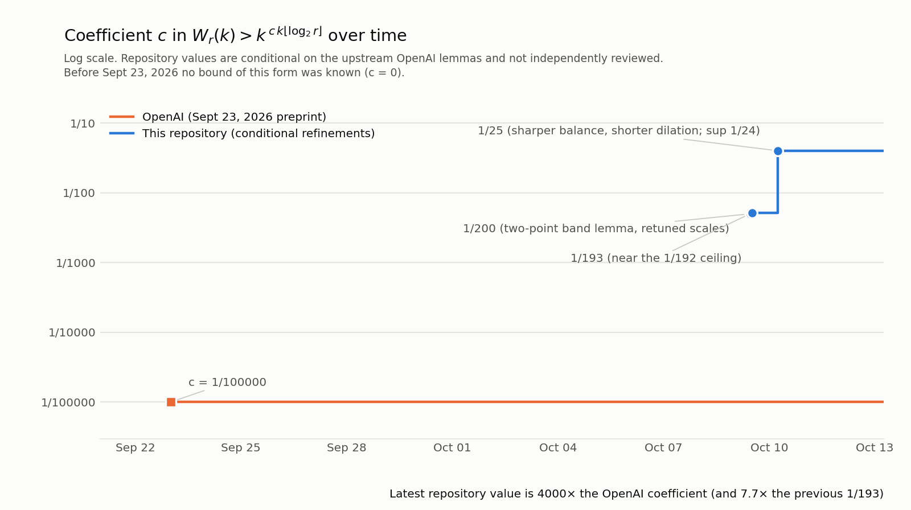

# Conditional refinements of OpenAI's October 2026 math release

This research draft proposes a stronger coefficient in the released van der Waerden lower bound, together with an elementary geometric lemma and a parameter-transfer argument. It also gives an abstract obstruction for a selected set of matrix-multiplication profile inequalities.

**Status:** AI-generated mathematical research prepared with Codex. The main refinement is conditional on the upstream geometric and counting arguments; it has not received independent mathematical review or formal verification. This repository does not claim a verified world record or a new matrix-multiplication algorithm. It is an independent follow-up, not an official OpenAI publication.

Read the full argument in **[research-note.tex](research-note.tex)**. Exact checks, parameter choices, and experimental records are included below.

## Main proposed refinement

The original manuscript establishes a bound of the form

```math
W_r(k)>k^{c k\lfloor\log_2 r\rfloor}
```

with $c=1/100000$, for sufficiently large $k$ and every integer $r\ge2$. Our conditional parameter-transfer argument admits **$c=1/25$**, with the threshold independent of $r$, and every fixed $c\lt1/24$ in the same sharpened region.

That is a **4000-fold increase in the coefficient inside the exponent** (and $193/25\approx7.72$ times the previous explicit choice $1/193$). The earlier $1/193$ and $1/200$ choices remain included for comparison. No explicit finite coloring record or runtime improvement follows. The threshold may be very large and is not made explicit here.

### Progress over time



The data behind the chart are in [progress/progress.json](progress/progress.json) and the chart is regenerated by [progress/progress_chart.py](progress/progress_chart.py). Plain-language summaries of each step are in [progress/](progress/).

### Why the argument changes

The source bounds the multiplicity of a geometric key by four. Its affinity and separation properties place points of one key on an affine real line, at mutual distances at least one, with squared norms in a half-open interval $[m,m+1)$.

In fact there are at most **two** such points. Parameterize the line by signed arclength $t$ from its nearest point to the origin, so squared norm is $t^2+C$. Among three parameters, two lie on the same half-line. Their absolute values satisfy $v-u\ge1$, hence

```math
v^2-u^2=(v-u)(v+u)\ge1,
```

contradicting membership in a common half-open interval of width one. This elementary lemma is proved directly; applying it to the original construction still requires the source's hypotheses.

Using this multiplicity bound, write $D=\lceil k^a\rceil$, $M=\lceil k^m\rceil$, and $p=k^{-b}$. The note derives the sufficient region

```math
a,b,c>0,\quad 3a\lt m\lt 1,\quad b\lt a,\quad 3a\lt 1-b,
```

```math
0<\delta<1,\quad 0<\gamma\le\delta/4,\quad \gamma<(1-\delta)/8,\quad 2c<\gamma b/2.
```

| Choice | $a$ | $m$ | $b$ | $\delta$ | $\gamma$ | $c$ | Coefficient ratio |
|---|---|---|---|---|---|---|---|
| Original dimension scales | 1/10 | 1/2 | 1/20 | 1/10 | 1/40 | 1/4000 | 25 |
| Retuned parameters | 1/5 | 3/4 | 1/6 | 1/10 | 1/40 | 1/1000 | 100 |
| Earlier 500-fold choice | 1/4 | 4/5 | 247/1000 | 1/3 | 41/500 | 1/200 | 500 |
| New proposed choice | 1/4 | 4/5 | 2499/10000 | 1/3 | 83/1000 | 1/193 | 100000/193 |

The new choice has strictly positive exact margins and stays below the retained region's endpoint $1/192$. Its full transfer argument and margin table are in [near-limit-proof.md](near-limit-proof.md).

For the earlier 500-fold row, $\gamma b/2-2c=127/1000000$ and both affine entropy power gaps equal $3/1000$. These strict margins are checked with exact rational arithmetic in [parameters.json](parameters.json) and [audit_math.py](audit_math.py).

The same sufficient region admits every fixed positive $c<1/192$. The endpoint is not asserted, and this is only a supremum within the retained estimates. The full transfer proof and its dependencies are in the note; passing the scripts does not establish that transfer as a theorem.

### Breaking the $1/192$ ceiling: the sharpened region

The $1/192$ supremum comes from two fixed choices inside the source argument, not from its geometry. First, the outer coloring is only asked to place **one quarter** of each bit on every tested set of labels, which caps $\gamma$ at $1/12$. Second, the short-period cutoff $h_0=D^2$ makes the global label entropy $k^{3a}$, which caps $b$ at $1/4$. The note's new Section 4 changes three things, with the source's geometric lemmas, anchored pattern count, affinity lemma, prime bound, and digit product untouched:

1. **Shorter dilation.** Take $h_0=D\lceil\log k\rceil^2$ and $\eta=\varepsilon_{\rm r}/(8D)$. The dilation lemma still holds, the nonregular fraction becomes $\le\varepsilon_{\rm r}$, and the global entropy drops to $O(k^{2a}\log^3k)$.
2. **Sharper balance.** Ask the local lemma for a $(1/2-\varepsilon)$ fraction of each bit instead of one quarter. The Hoeffding-type tail $2e^{-2\varepsilon^2 l}$ and weights $e^{-\varepsilon^2 l}$ satisfy the asymmetric local-lemma criterion for every fixed $\varepsilon$, since all tested sizes are unbounded.
3. **Balance the light positions outside heavy blocks.** Those positions are a function of the label word, so they get their own first-family event. Heavy blocks and these light positions then cover all but $h+\delta k=o(k)+\delta k$ positions.

The resulting sufficient region is

```math
a,b,c>0,\quad 2a\lt m\lt 1,\quad b\lt a,\quad 2a\lt 1-b,
```

```math
0<\varepsilon<\tfrac12,\quad 0<\varepsilon_{\rm r}\le\tfrac12,\quad 0<\delta,\quad
\gamma<(\tfrac12-\varepsilon)(1-\varepsilon_{\rm r})(1-\delta),\quad 2c<\gamma b/2,
```

so $b\lt1/3$, $\gamma\lt1/2$, and $c\lt\gamma b/4\lt1/24$; every fixed $c\lt1/24$ is admitted.

| Choice | $a$ | $m$ | $b$ | $\delta$ | $\varepsilon$ | $\varepsilon_{\rm r}$ | $\gamma$ | $c$ | Coefficient ratio |
|---|---|---|---|---|---|---|---|---|---|
| Sharpened explicit choice | 333/1000 | 4/5 | 331/1000 | 1/200 | 1/200 | 1/200 | 97/200 | 1/25 | 4000 |

Its decisive margins are $\gamma b/2-2c=107/400000$, $1-b-2a=3/1000$, $a-b=1/500$, and $(1/2-\varepsilon)(1-\varepsilon_{\rm r})(1-\delta)-\gamma=40499/8000000$. The full argument and margin table are in [sharpened-region-proof.md](sharpened-region-proof.md); `audit_math.py` checks them exactly and rejects five boundary controls, including $c=1/24$ itself.

## Original work and attribution

All comparisons refer to **OpenAI's manuscripts at commit [`fd4aeeb2ee4fc729c18d98444fed42fd0529eeeb`](https://github.com/openai/math/tree/fd4aeeb2ee4fc729c18d98444fed42fd0529eeeb)**, not to a claim about the latest literature.

- OpenAI, [*Quantitative Superexponential Bounds for van der Waerden Numbers*](https://github.com/openai/math/tree/fd4aeeb2ee4fc729c18d98444fed42fd0529eeeb/preprints/Quantitative-Superexponential-Bounds-for-van-der-Waerden-Numbers-September-23-2026), September 23, 2026. This is the original construction on which the main refinement depends.
- OpenAI, [*An Upper Bound of 9/4 for the Matrix Multiplication Exponent*](https://github.com/openai/math/tree/fd4aeeb2ee4fc729c18d98444fed42fd0529eeeb/preprints/Matrix-Multiplication-Nine-Fourths-October-2-2026), October 2, 2026. Source of the profile constraints considered here.
- OpenAI, [*A counterexample to Sidorenko's conjecture*](https://github.com/openai/math/tree/fd4aeeb2ee4fc729c18d98444fed42fd0529eeeb/preprints/A-counterexample-to-Sidorenkos-conjecture-September-23-2026), September 23, 2026. Source of the finite certificate reproduced for exploratory searches.
- OpenAI, [*A power saving for planar unit distances*](https://github.com/openai/math/tree/fd4aeeb2ee4fc729c18d98444fed42fd0529eeeb/preprints/A-power-saving-for-planar-unit-distances-September-23-2026), September 23, 2026. Inspected for possible quantitative improvements; none is claimed.

The original authors retain credit for their constructions, lemmas, and results. The finite Sidorenko baseline is derived from the original manuscript. [source-manifest.json](source-manifest.json) records the pinned revision and SHA-256 hashes of the inspected source files. Upstream source trees are not bundled; the fetch command below retrieves and verifies them from the original repository. Citation entries supplied by the authors are available in the linked original directories.

## Companion result and unsuccessful searches

For the selected scalar matrix-profile constraints, let $u=\min(a,b)$ and $v=\max(a,b)$. The explicit profile

```math
P_*(a,b)=\left(\frac{3u-1}{2}\right)^{1/3}\left(v+\frac{u-1}{2}\right)
```

is symmetric, positive, nondecreasing, and separately concave, with $P_*(1,b)=b$. It satisfies shifted tripling and the rank envelope at $t=3/4$, while its diagonal grows as $\Theta(a^{4/3})$. Thus those listed constraints alone cannot exclude $t=3/4$. **This is not an actual tensor character or a lower bound on the matrix-multiplication exponent.** The note gives an analytic proof; finite LP experiments are exploratory.

The Sidorenko search found **no smaller certificate**: 56,984 labeled candidates in the contraction/flip run, and 28,281 in the weighted-cut run, of which 2,518 passed the discrete and degree screen. These nonexhaustive searches may overlap and include isomorphic duplicates. Floating-point LP failures are not infeasibility certificates. The original 35-vertex, 66-edge finite certificate passes the independent combinatorial checker; this does not verify the full analytic counterexample proof.

No improved unit-distance exponent was obtained.

## Reproduce the checks

Use Python 3.11 or 3.12 in a local checkout:

```sh
python3 -m venv .venv
. .venv/bin/activate
python -m pip install -r requirements.txt
python -B audit_math.py
python -B check_complex.py experiments/complex-contractions/baseline.json --output experiments/baseline-independent-check.json
```

Do not run with `-O` or `PYTHONOPTIMIZE`: the verification scripts use assertions. GitHub Actions runs these same checks on pushes and pull requests.

| Check | Evidence | Limitation |
|---|---|---|
| Four parameter proposals | Exact rational margins for four choices; three invalid boundary controls rejected | Validates inequalities, not the imported lemmas |
| Sharpened region, $c=1/25$ | Exact rational margins for the explicit choice; five boundary controls rejected, including $c=1/24$ | Validates inequalities, not the modified local-lemma transfer |
| Norm-band lemma | Displayed proof plus 26,180 finite rational cases | Finite cases supplement the proof |
| Abstract matrix profile | Symbolic identities plus 10,000 exact cube comparisons | No tensor realizability claim |
| Released Sidorenko baseline | Independent reconstruction; duplicate-face and incomplete-exposure controls rejected | Finite combinatorial hypotheses only |

Saved outputs are [exact-audit.json](experiments/exact-audit.json) and [baseline-independent-check.json](experiments/baseline-independent-check.json). The LaTeX source was successfully compiled in the Codex document editor; no compiled PDF is included.

To retrieve the exact upstream source files (optional for the checks above):

```sh
python -B fetch_sources.py --output upstream
```

Exploratory scripts provide `--help`: [search_complex.py](search_complex.py), [weighted_cuts.py](weighted_cuts.py), and [profile_lp.py](profile_lp.py). Searches require explicit seeds, time budgets, and output paths. Their wall-clock-limited candidate counts are machine-dependent; historical summaries are retained under [experiments](experiments/). Use a new output directory when rerunning a search to preserve those records.

## What still needs review

The main outstanding work is independent verification of the complete van der Waerden parameter transfer, including uniform constants and all imported hypotheses. The sharpened region additionally relies on the three modifications in Section 4 of the note (shorter dilation, $(1/2-\varepsilon)$-balance in the local lemma, and the separate balancing of light positions outside heavy blocks); each is argued in [sharpened-region-proof.md](sharpened-region-proof.md) but has not been independently reviewed. Pushing past $1/24$ would need a new idea for the $q^{2D}$ union bound over progressions or the two-point key multiplicity, neither of which is addressed here. Literature priority has not been established. For matrix multiplication, progress requires additional valid tensor constraints or a different construction. Any smaller Sidorenko finite object would still need the full analytic transfer before it could be called a new counterexample.
